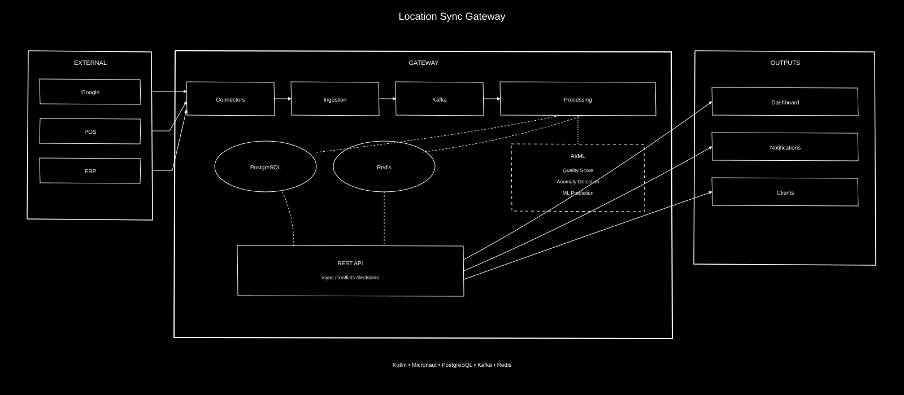

# Location Sync Gateway

<div align="center">

[](https://kotlinlang.org/)
[](https://micronaut.io/)
[](https://www.postgresql.org/)
[](https://kafka.apache.org/)

**Intelligent data conflict resolution engine for multi-location businesses**

[Quick Start](#quick-start) • [Architecture](#architecture) • [Features](#features) • [API](#api-documentation)

</div>

---

## Overview

An event-driven microservice that detects and automatically resolves data conflicts between external sources (Google My Business, POS systems, ERP) and your centralized location management platform. Prevents data wars, maintains consistency, and ensures customers always see accurate business information.

### The Problem

- **Franchisees edit Google directly** → Platform overwrites → Endless conflict cycle
- **POS shows zero transactions** → Branch closed for renovation → Nobody updates listings → Angry customers
- **HQ sets standard hours** → Local franchisee needs different hours → Data inconsistency across platforms

### The Solution

Automated conflict detection and intelligent resolution with AI-powered quality validation, anomaly detection, and machine learning predictions.

---

## Architecture

**Event-Driven Pipeline** • **Horizontally Scalable** • **AI-Powered**

<div align="center">
  
</div>

📖 **[View Detailed Architecture Documentation](docs/ARCHITECTURE.md)** - Complete ASCII diagrams, data flow, and component details

### Key Components

1. **Connector Layer** - Pluggable data source integrations
2. **Ingestion Layer** - Scheduled data pulls with validation
3. **Event Streaming** - Kafka for async processing
4. **Processing Layer** - Conflict detection and resolution engine
5. **Storage Layer** - PostgreSQL + Redis for persistence and caching
6. **AI/ML Layer** - Quality scoring, anomaly detection, ML predictions
7. **REST API** - Management interface and integrations

---

## Features

### Core Capabilities
- ✅ **Multi-Source Ingestion** - Google My Business, POS, ERP, custom webhooks
- ✅ **Field-Level Conflict Detection** - Phone, hours, coordinates, categories, address
- ✅ **Configurable Resolution Rules** - YAML-based, version-controlled policies
- ✅ **Automated Execution** - API updates, sync triggers, notifications
- ✅ **Full Audit Trail** - Every decision logged for compliance
- ✅ **OAuth 2.0 Integration** - Secure external API access

### AI-Powered Intelligence
- 🤖 **Quality Scoring** (0-100) - Validates data completeness and accuracy
- 🎯 **Anomaly Detection** - Isolation Forest catches suspicious patterns
- 🧠 **ML Resolution Prediction** - XGBoost learns from historical decisions
- 💬 **Natural Language Explanations** - LLM-generated decision summaries

### Resolution Outcomes

| Outcome | Action | Use Case |
|---------|--------|----------|
| **AUTO_ACCEPT** | Update platform with external value | Franchisee sets local hours |
| **AUTO_REVERT** | Trigger sync to revert external edit | Unauthorized category change |
| **FLAG_FOR_REVIEW** | Send notification for human review | POS signals possible closure |

---

## Quick Start

### Prerequisites
- JDK 17+
- PostgreSQL 16+
- Docker (for Kafka, Redis)

### Run with Docker

```bash
# Clone repository
git clone https://github.com/c-kiplimo/Location-Sync-Gateway.git
cd Location-Sync-Gateway

# Start all services
docker-compose up -d

# Run application
./gradlew run
```

Application starts at **http://localhost:9096**

### Run Development Mode (No Docker)

```bash
# Uses H2 in-memory database
set MICRONAUT_ENVIRONMENTS=dev && ./gradlew run
```

### Test the API

```bash
# Generate test data
curl -X POST "http://localhost:9096/api/v1/simulation/generate?count=100"

# View detected conflicts
curl http://localhost:9096/api/v1/conflicts

# View resolution decisions
curl http://localhost:9096/api/v1/decisions

# Health check
curl http://localhost:9096/health
```

---

## API Documentation

### Core Endpoints

| Method | Endpoint | Description |
|--------|----------|-------------|
| POST | `/api/v1/sync/trigger` | Trigger manual sync |
| GET | `/api/v1/conflicts` | List all conflicts |
| GET | `/api/v1/conflicts/flagged` | Conflicts needing review |
| GET | `/api/v1/decisions` | List resolution decisions |
| POST | `/api/v1/rules` | Create resolution rule |
| GET | `/health` | System health check |

**Interactive Swagger UI**: http://localhost:9096/swagger-ui

### Example Response

```json
{
  "id": "550e8400-e29b-41d4-a716-446655440000",
  "locationId": 1001,
  "fieldType": "OPENING_HOURS",
  "source": "GOOGLE_MY_BUSINESS",
  "outcome": "AUTO_ACCEPT",
  "reason": "Franchisee allowed to set local hours",
  "confidence": 0.95,
  "decidedAt": "2026-10-16T10:30:00Z"
}
```

---

## Resolution Rules

Rules defined in `resolution-rules.yml`:

```yaml
rules:
  - name: google-opening-hours-franchisee
    fieldType: OPENING_HOURS
    source: GOOGLE_MY_BUSINESS
    locationPattern: "franchise.*"
    defaultOutcome: AUTO_ACCEPT
    minimumConfidence: 0.9
    conditions:
      - type: VALUE_WITHIN_RANGE
        field: openingHourSpan
        min: 6
        max: 16

  - name: google-phone-hq-override
    fieldType: PHONE
    source: GOOGLE_MY_BUSINESS
    defaultOutcome: AUTO_REVERT
    minimumConfidence: 1.0
    reason: "Phone numbers centrally managed"

  - name: pos-temporary-closure
    fieldType: TEMPORARY_CLOSURE
    source: POS_SYSTEM
    defaultOutcome: FLAG_FOR_REVIEW
    minimumConfidence: 0.85
    notifyChannel: slack
```

---

## Configuration

```yaml
# application.yml
micronaut:
  application:
    name: location-sync-gateway
  server:
    port: 9096

datasources:
  default:
    url: jdbc:postgresql://localhost:5432/location_sync_gateway
    username: postgres
    password: ${DB_PASSWORD}

kafka:
  bootstrap:
    servers: localhost:9092

redis:
  uri: redis://localhost:6379

google:
  oauth:
    clientId: ${GOOGLE_OAUTH_CLIENT_ID}
    clientSecret: ${GOOGLE_OAUTH_CLIENT_SECRET}

scheduler:
  ingestion:
    enabled: true
    fixedDelay: 5m

notifications:
  slack:
    webhookUrl: ${SLACK_WEBHOOK_URL}
    channel: "#location-ops-alerts"
```

---

## Technology Stack

- **Backend**: Kotlin + Micronaut Framework
- **Database**: PostgreSQL 16 + R2DBC (reactive)
- **Event Streaming**: Apache Kafka
- **Caching**: Redis
- **Auth**: OAuth 2.0
- **Migrations**: Flyway
- **Monitoring**: Prometheus + Grafana
- **AI/ML**: Python FastAPI + XGBoost + Scikit-learn
- **LLM**: OpenAI GPT-4 / Anthropic Claude

---

## Project Structure

```
src/main/kotlin/com/locationsync/gateway/
├── Application.kt
├── connector/
│   ├── GoogleMyBusinessConnector.kt
│   ├── PosSystemConnector.kt
│   └── ErpSystemConnector.kt
├── controller/
│   ├── SyncController.kt
│   ├── ConflictsController.kt
│   └── RulesController.kt
├── model/
│   ├── Conflict.kt
│   ├── LocationSnapshot.kt
│   └── ResolutionDecision.kt
├── service/
│   ├── ConflictDetector.kt
│   ├── ResolutionEngine.kt
│   └── ai/
│       ├── QualityScorer.kt
│       ├── AnomalyDetector.kt
│       └── ResolutionPredictor.kt
├── kafka/
│   ├── SnapshotProducer.kt
│   └── SnapshotConsumer.kt
└── repository/
    ├── ConflictRepository.kt
    └── DecisionRepository.kt
```

---

## Development

### Build
```bash
./gradlew clean build
```

### Run Tests
```bash
./gradlew test
```

### Database Migrations
Auto-applied via Flyway on startup from `src/main/resources/db/migration/`

---

## Monitoring & Observability

### Metrics (Prometheus)
- `conflicts_detected_total{source,field_type}`
- `decisions_executed_total{outcome}`
- `api_latency_seconds`
- `connector_pull_duration_seconds`

### Health Checks
```bash
curl http://localhost:9096/health
```

```json
{
  "status": "UP",
  "checks": [
    {"name": "postgres", "status": "UP"},
    {"name": "kafka", "status": "UP"},
    {"name": "redis", "status": "UP"},
    {"name": "connectors", "status": "UP"}
  ]
}
```

### Dashboards
- **Prometheus**: http://localhost:9090
- **Grafana**: http://localhost:3000

---

## Use Cases

### 1. Franchisee Updates Hours
**Detection**: Google connector detects hours changed to 8am-8pm
**Resolution**: AUTO_ACCEPT (franchisees control local hours)
**Action**: Update central platform
**Result**: Both systems aligned, no data war

### 2. POS Signals Closure
**Detection**: Zero transactions for 3 days
**Resolution**: FLAG_FOR_REVIEW (needs confirmation)
**Action**: Slack notification to ops team
**Result**: Manual verification prevents false positive

### 3. Unauthorized Category Change
**Detection**: Category changed from "Restaurant" to "Bar"
**Resolution**: AUTO_REVERT (categories centrally controlled)
**Action**: Trigger sync to revert
**Result**: Brand consistency maintained

---

## Contributing

1. Fork the repository
2. Create feature branch (`git checkout -b feature/amazing-feature`)
3. Commit changes (`git commit -m 'Add feature'`)
4. Push to branch (`git push origin feature/amazing-feature`)
5. Open Pull Request

---

## License

MIT License - see [LICENSE](LICENSE)

---

## Documentation

- [Setup Guide](SETUP_SUMMARY.md)
- [Architecture Details](docs/ARCHITECTURE.md) - Complete visual diagrams and data flow
- [Cleanup Summary](CLEANUP_SUMMARY.md) - Recent code cleanup and improvements
- [API Documentation](http://localhost:9096/swagger-ui) - Interactive Swagger UI

---

<div align="center">

**Event-Driven • AI-Powered • Production-Ready**

[Report Bug](https://github.com/c-kiplimo/Location-Sync-Gateway/issues) • [Request Feature](https://github.com/c-kiplimo/Location-Sync-Gateway/issues)

</div>
